# 🔬 AI Research Paper & PDF Assistant

> **An enterprise-grade, researcher-focused Retrieval-Augmented Generation (RAG) system** that reads academic research papers, technical reports, and PDFs, answering questions with exact page references, evidence quotes, multi-paper comparative matrices, and automated faithfulness/hallucination evaluations.

---

## 🌟 What This Proves
This project is an advanced demonstration of modern AI engineering skills across four foundational domains:
1. **Natural Language Processing (NLP)**: Page-aware tokenization, sentence-boundary preserving chunking, scientific section classification, lexical TF-IDF/BM25 scoring, and claim-level NLI entailment verification.
2. **LLM Integration**: Structured prompt engineering for academic citation compliance, multi-provider model routing (Google Gemini, OpenAI GPT-4o, and deterministic local extractive fallbacks), JSON schema validation, and meta-review synthesis.
3. **Information Retrieval (IR)**: Dense vector embeddings (`text-embedding-004`, `text-embedding-3-small`), persistent ChromaDB vector storage, and **Hybrid Search Fusion** combining dense semantic similarity with sparse BM25 keyword matching ($\alpha \cdot \text{Dense} + (1-\alpha) \cdot \text{Sparse}$).
4. **Full-Stack Backend Development**: Clean separation of concerns with asynchronous FastAPI REST endpoints, Pydantic data modeling, and a reactive Streamlit researcher dashboard.

---

## 🏗️ System Architecture

```mermaid
flowchart TD
    subgraph UI ["Researcher UI (Streamlit)"]
        UI_Upload["📄 Document Hub & ArXiv Ingestion"]
        UI_Chat["💬 Q&A with Page References"]
        UI_Compare["⚖️ Multi-Paper Comparative Matrix"]
        UI_Eval["📊 Faithfulness & Hallucination Metrics"]
        UI_Search["🔍 Hybrid Retrieval Diagnostics"]
        UI_Summary["📑 Executive Summarizer"]
    end

    subgraph Backend ["FastAPI Backend REST Service"]
        EP_Upload["POST /api/upload"]
        EP_Arxiv["POST /api/arxiv"]
        EP_Query["POST /api/query"]
        EP_Compare["POST /api/compare"]
        EP_Eval["POST /api/evaluate"]
        EP_Search["POST /api/search"]
        EP_Summary["POST /api/summarize"]
        EP_Docs["GET & DELETE /api/documents"]
    end

    subgraph CoreEngine ["RAG & NLP Engine"]
        PDF_Proc["PDF Processor (pypdf, Page tracking, Section headers)"]
        Embedder["Embedding Engine (Gemini / OpenAI / Fallback)"]
        Retriever["Hybrid Dense-Sparse Fusion (ChromaDB + BM25)"]
        LLM_Serv["Academic Synthesis & Citation Router"]
        Evaluator["Evaluation Metric Suite (Faithfulness, Relevance, Hallucinations)"]
        Arxiv_Client["ArXiv API & PDF Fetcher"]
    end

    subgraph Persistence ["Persistent Storage Layer"]
        ChromaStore[("ChromaDB Vector Store")]
        FileStore[("data/uploads/ PDF Archive")]
        MetaStore[("data/metadata.json")]
    end

    UI --> Backend
    Backend --> CoreEngine
    CoreEngine --> Persistence
```



---

## ✨ Advanced Features

### 1. 📄 PDF Ingestion & Page-Aware Chunking
- Preserves exact physical page numbers (`Page 1`, `Page 2`, ...) across all document chunks.
- Automatically recognizes academic section headers (`Abstract`, `Introduction`, `Methodology`, `Results`, `Conclusion`).
- Chunks sentences cleanly without cutting mid-word or breaking mathematical definitions.

### 2. 🌐 Direct ArXiv Paper Ingestion
- Allows pasting any arXiv ID or URL (e.g. `1706.03762` or `https://arxiv.org/abs/2312.11805`).
- Fetches metadata (title, authors, publication date, abstract) directly from the official arXiv API and downloads the original PDF.

### 3. 🔍 Semantic & Hybrid Search Fusion
- Combines semantic vector similarity (capturing conceptual meaning) with lexical BM25/TF-IDF scoring (capturing exact acronyms, dataset names, model names like "Transformer", "BLEU-4", "ResNet").
- Configurable **Alpha weight** slider ($0.0 \le \alpha \le 1.0$) to dynamically tune semantic vs. keyword priority.

### 4. 📚 Verbatim Citations & Evidence Explorer
- Every factual answer provides explicit citation badges: `[Source X, p. Y]`.
- Displays verbatim quote snippets extracted from the paper along with relevance scores.
- Context inspector allows viewing the raw context passages retrieved from ChromaDB.

### 5. ⚖️ Multi-Document Comparison Matrix
- Select 2 or more research papers to compare side-by-side.
- Evaluates across core academic dimensions:
  - Research Objective & Problem Statement
  - Proposed Methodology & Architecture
  - Datasets & Experimental Benchmarks
  - Key Quantitative Results
  - Limitations & Future Work
- Exports comparison reports as Markdown files.

### 6. 📊 Answer Evaluation & Hallucination Detection
- Quantitative assessment benchmark:
  - **Faithfulness (Groundedness)**: Checks if every claim in the generated answer is entailed by the retrieved context chunks.
  - **Answer Relevance**: Measures how directly the response satisfies the researcher's query.
  - **Context Coverage**: Assesses how effectively key facts from the context were utilized.
  - **Hallucination Risk Level**: Categorized as `Low`, `Moderate`, or `High`.
  - **Claim-by-Claim Breakdown**: Displays each factual statement, its verification status, and supporting evidence chunk.

### 7. 📑 Executive Summarizer
- Synthesizes comprehensive summaries, executive briefs, methodology highlights, and key takeaways for any paper in the library.

---

## 🛠️ Tech Stack
- **Backend**: Python 3.10+, FastAPI, Uvicorn, Pydantic v2.
- **Frontend**: Streamlit, Custom Responsive CSS.
- **Vector Database**: ChromaDB (persistent vector storage).
- **PDF Extraction**: PyPDF (pure Python, high-accuracy text extraction).
- **Embeddings & LLMs**: Google Gemini (`google-genai` SDK), OpenAI GPT-4o (`openai` SDK), Scikit-Learn (TF-IDF / BM25 lexical ranking).
- **External APIs**: ArXiv Export API.

---

## 🚀 Quickstart Guide

### 1. Clone & Set Up Virtual Environment
```bash
# Navigate to the project directory
cd ai_research_assistant

# Create and activate virtual environment
python -m venv .venv

# Windows:
.\.venv\Scripts\activate

# Linux / macOS:
source .venv/bin/activate
```

### 2. Install Dependencies
```bash
pip install -r requirements.txt
```

### 3. Configure API Keys (Optional)
Copy `.env.example` to `.env`:
```bash
cp .env.example .env
```
Add your `GEMINI_API_KEY` or `OPENAI_API_KEY`.  
*(Note: You can also enter or switch API keys directly inside the Streamlit web interface! If no key is entered, the app seamlessly runs in Local Extractive RAG mode.)*

### 4. Launch the Application

#### Option A: One-Click Launcher (Recommended)
```bash
python run_all.py
```
This concurrently starts:
- **FastAPI Backend**: `http://127.0.0.1:8000` (Swagger docs at `http://127.0.0.1:8000/docs`)
- **Streamlit Frontend**: `http://localhost:8501`

#### Option B: Run Separately
In Terminal 1 (Backend):
```bash
python run_backend.py
```

In Terminal 2 (Frontend):
```bash
python run_frontend.py
```

---

## 📡 API Endpoints

| Method | Endpoint | Description |
| :--- | :--- | :--- |
| `GET` | `/` | Service health status |
| `GET` | `/api/documents` | Lists all indexed research papers and metadata |
| `POST` | `/api/upload` | Uploads and vector-indexes one or more PDF files |
| `POST` | `/api/arxiv` | Fetches and indexes paper directly from arXiv URL/ID |
| `POST` | `/api/query` | RAG query answering with citations and confidence score |
| `POST` | `/api/search` | Direct dense & sparse hybrid retrieval explorer |
| `POST` | `/api/compare` | Multi-paper comparative matrix analysis |
| `POST` | `/api/evaluate` | Evaluates faithfulness, relevance, and hallucination risk |
| `POST` | `/api/summarize` | Generates structured summary and key takeaways |
| `DELETE` | `/api/documents/{id}` | Deletes a document and its vector embeddings |

---

## 📂 Project Structure

```
ai_research_assistant/
│
├── .env.example              # Environment variables template
├── README.md                 # Full documentation
├── requirements.txt          # Python dependencies
├── run_backend.py            # FastAPI runner script
├── run_frontend.py           # Streamlit runner script
├── run_all.py                # Dual launcher for both services
│
├── backend/
│   ├── __init__.py
│   ├── config.py             # App configuration and directory paths
│   ├── main.py               # FastAPI application with all REST endpoints
│   ├── core/
│   │   ├── __init__.py
│   │   ├── pdf_processor.py  # Page-level extraction and section chunking
│   │   ├── vector_store.py   # ChromaDB management & Hybrid Dense-Sparse search
│   │   ├── embeddings.py     # Gemini, OpenAI, and local fallback vectorizers
│   │   ├── llm_service.py    # Academic citation prompts, comparison & summary
│   │   ├── evaluator.py      # Faithfulness, relevance & hallucination scoring
│   │   └── arxiv_client.py   # ArXiv API metadata & PDF downloader
│   └── models/
│       ├── __init__.py
│       └── schemas.py        # Pydantic request/response schemas
│
├── frontend/
│   ├── __init__.py
│   ├── app.py                # Streamlit Researcher Dashboard
│   └── components/
│       ├── __init__.py
│       └── styles.py         # Custom modern academic UI styles
│
└── data/
    ├── uploads/              # Stored PDF papers
    ├── vectordb/             # Persistent ChromaDB vector collections
    └── metadata.json         # Document registry
```
